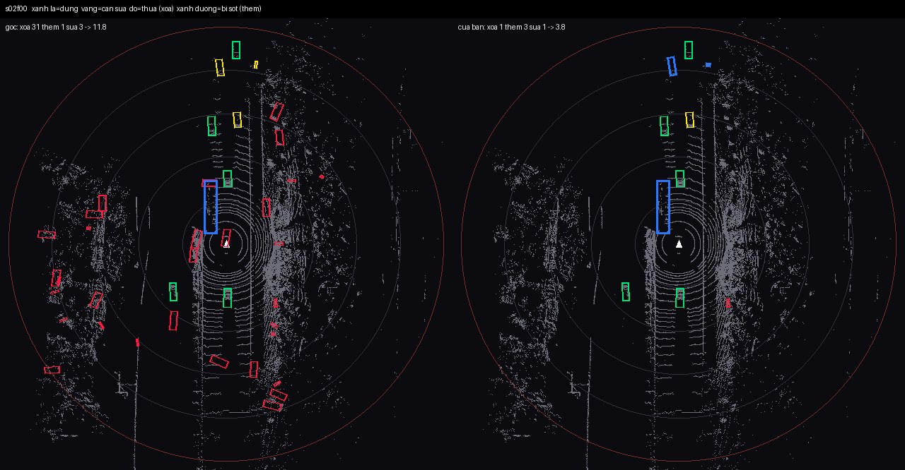

# Báo cáo Day 14 — Phan Hải Đăng — 2A202603229

- Mã học viên dùng với `--student`: `229`
- `seed_tag` trong `frames_A.txt`: `393590736f`

## 1. Dự đoán trước sweep (bước 5b)

- Tham số tôi nghĩ giảm công sửa nhiều nhất: **`score_thr`** (tăng lên khoảng `0.3`–`0.4`) kết hợp **`min_points`** (khoảng `5`).
- Vì sao (nhìn ảnh BEV tập A: box thừa nhiều hay box sót nhiều?): Trên ảnh BEV và số đo tập A, **box thừa (FP) áp đảo hoàn toàn** so với box sót (dự đoán `83` box nhưng GT chỉ `37` box, phải xóa `52` box trong khi chỉ thêm `6` box). Phần lớn box thừa là nhiễu ở rìa đường/bụi cây/hàng rào có `score` thấp (ví dụ `0.18`) hoặc rất ít điểm LiDAR. Dù xóa 1 box chỉ tốn `0.3` (thêm 1 box tốn `1.0`), lượng box thừa quá lớn (`52 × 0.3 = 15.6`, chiếm hơn nửa tổng chi phí `27.1`) nên tăng `score_thr` và `min_points` vừa phải sẽ cắt mạnh `xóa` mà chưa làm `thêm` tăng vọt.

## 2. Tập A: sửa tay và tune

| Cấu hình | Xóa | Thêm | Sửa | Chi phí |
|---|---:|---:|---:|---:|
| Gốc | 52 | 6 | 11 | 27.1 |
| `best_config.json` | 6 | 9 | 9 | 15.3 |

- Tham số đã đổi trong `best_config.json`: `score_thr: 0.1 -> 0.5`, `min_points: 0 -> 10`.
- Kết quả leave-one-out (dán các dòng `scripts/pp_sweep.py` in ra):
  ```text
  s02f00: cấu hình chọn {'score_thr': '0.5', 'min_points': '10'} → 3.8 (tốt nhất có thể 3.7)
  s04f42: cấu hình chọn {'score_thr': '0.5', 'min_points': '10'} → 3.8 (tốt nhất có thể 3.8)
  s05f15: cấu hình chọn {'score_thr': '0.5', 'min_points': '10'} → 7.7 (tốt nhất có thể 7.7)
  ```
- Cấu hình có ổn định trên từng frame không? Vì sao tôi vẫn chọn (hoặc không chọn) nó: Rất ổn định — cả 3 fold leave-one-out đều chọn cùng một cặp `{'score_thr': '0.5', 'min_points': '10'}` và chi phí đạt sát mức tối ưu tuyệt đối (`3.8 vs 3.7`, `3.8 vs 3.8`, `7.7 vs 7.7`). Tuy nhiên `score_thr=0.5` làm số box bị sót (`thêm`) tăng nhẹ từ `6 -> 9`, nên khi sang tập B cần rà kỹ các vật thể xa/nhỏ (`Pedestrian`, `Cyclist`) để không bỏ sót.

## 3. Trước/sau (bước 8)



- `scripts/pp_compare.py` báo **giảm 44%** công sửa trên tập A (`27.1 -> 15.3`, chi tiết: `s02f00`: `11.8 -> 3.8`, `s04f42`: `4.9 -> 3.8`, `s05f15`: `10.4 -> 7.7`).
- Dự đoán ở mục 1 đúng hay sai? Giải thích bằng số box xóa/thêm/sửa: **Đúng hướng**, nhưng mức tối ưu thực tế mạnh hơn dự đoán (`score_thr=0.5, min_points=10` thay vì `0.3–0.4, min_points=5`). Việc nâng ngưỡng giúp `xóa` giảm rất mạnh từ `52 -> 6` (tiết kiệm `13.8` điểm chi phí) và `sửa` giảm từ `11 -> 9`, trong khi `thêm` chỉ tăng nhẹ từ `6 -> 9` (tốn thêm `3.0` điểm). Tổng thể giảm ròng `11.8` điểm chi phí (`44%`).

## 4. Tập B

Số đo từ `scripts/pp_prelabel.py --frames d14_229/frames_B.txt --config d14_229/best_config.json --gt d14_229/ref_B.json`:

| Xóa | Thêm | Sửa | Chi phí |
|---:|---:|---:|---:|
| 29 | 47 | 63 | 87.2 |

*(Tổng 12 frame: GT `181` hộp, dự đoán `163` hộp, khớp `134` hộp.)*

- Loại box tốn công sửa nhất ở tập B: **Box bị bỏ sót phải thêm mới (`thêm 47`, tốn `47.0 / 87.2` điểm chi phí)** — chủ yếu là `Pedestrian`, `Cyclist` và xe ở xa/bị che khuất bị rơi do `score_thr=0.5, min_points=10` (nổi bật ở `s03f21` thêm `13`, `s05f45` thêm `7`), tiếp theo là **chỉnh sửa hộp khớp (`sửa 63`, tốn `31.5` điểm)** do lệch tâm/kích thước/góc yaw hoặc phải đổi lớp sang `Truck`/`Bus`.

## 5. Giới hạn

- **Tập tune quá nhỏ (chỉ 3 frame tập A):** Dễ overfit vào phân bố riêng của 3 frame đó. Trên tập A, `score_thr=0.5` giúp giảm mạnh `xóa` (`52 -> 6`) và tổng chi phí giảm `44%`, nhưng sang 12 frame tập B thì số box bị sót (`thêm 47`) tăng cao, đẩy chi phí `thêm` lên quá nửa tổng chi phí.
- **Giới hạn miền dữ liệu của model KITTI:** PointPillars chỉ train trên 3 lớp (`Car`, `Cyclist`, `Pedestrian`) với LiDAR 64 tia nhìn phía trước, nên không nhận diện được `Truck`/`Bus` (hay cắt đôi xe buýt thành 2 `Car` hoặc gán nhầm class) và hay sót người đi bộ/xe hai bánh trên dữ liệu VF.
- **Công thức chi phí chỉ là xấp xỉ:** `0.3·xóa + 1.0·thêm + 0.5·sửa` chưa phản ánh thời gian thực tế để rà các ca khuất/xa (`LOW_VISIBILITY`, ví dụ hàng xe đỗ sau đồi cỏ/hàng rào ở `s02f00` hướng `cam07`/`cam08` quá thưa điểm nên bỏ qua thay vì đoán) và chỉ tính các hộp trong bán kính `50 m`.
